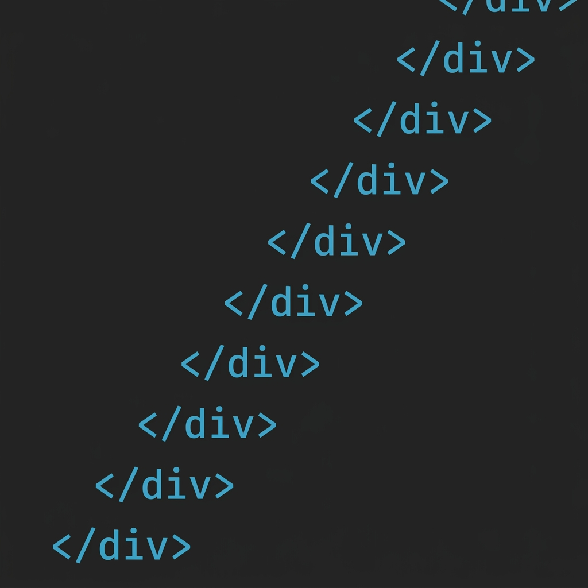

{width=65% fig-align="center"}

どうも。nikodehyakuenです。
思ったこと、気になったことを適当にブログにしていきます。

最近は、モダンWeb開発にお熱です。\
地方の国立大学で情報学を専攻していますが、いつかはRAMとCPU、アセンブリ、OS、まで自分で作って、その仕組みをすべて知りたいものです。

そして今は何といってもAIがあるおかげで、個人の学習効率はとてつもなく上がっていますね。\
結局、勉強するって本を読んで、ノートをとるだけじゃないですからね。\
どれだけの知識が頭に入ったかが大事なわけです。\
私たちが日本語を話せるようになったのはきれいなノートを作ったからじゃないですし。\
こういう勉強の仕方もありなのかなとは思います。

実際、勉強することっていうのは成果物を作るために必要な前提を埋める布石でしかないわけで、勉強すること自体に価値を見出すのは違うのかもしれませんね。\
どれだけAIを使っても、実際に価値を生み出すことはえらいことだと思います。\

いろいろな意見はありますが、AIが登場したことで現代の人の考える力が失われたとか、頑張らなくなったとか、その辺の意見には私は反対です。\
AIのおかげで頑張らなくなったのではなく、頑張らなくてもいいところに頑張る必要がなくなっただけだと思いますね。\
大学のレポートだって、AIで書かれて困る、というレベルのレポートなら、出さなくても一緒だと思います。

大学においても、講義についていけなくなるという意見については、結局将来困るのは自分ですから、大学側が心配することもないのかなとは思います。\
逆に、「今はAIに頼るべきなのか」、「今AIに頼ったらのちの自分がつらいのか」を判断できるようになることのほうが今身に着けるべきスキルとして大事なのかなとは思いますね。

自戒です。では次回。